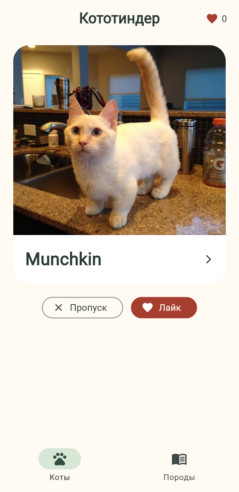
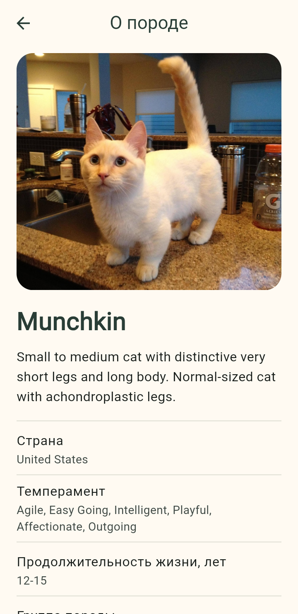
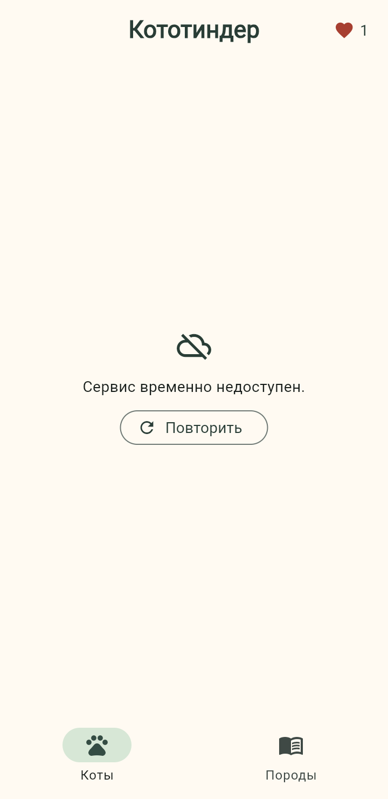
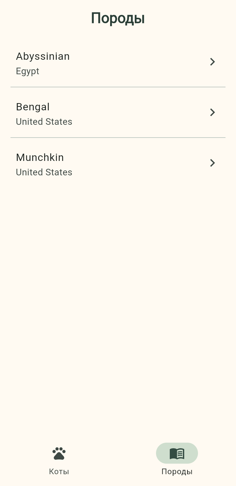
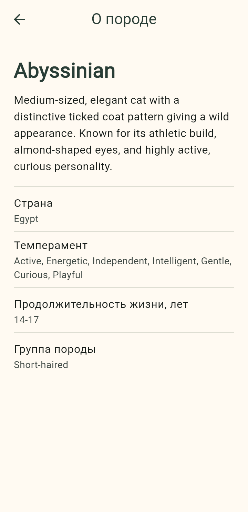

# Кототиндер

## 1. Описание приложения

Android-приложение для знакомства с породами кошек. В ленте можно рассматривать случайных котов и отмечать понравившихся, а в каталоге — выбирать породы по названию. Данные и фотографии предоставляет TheCatAPI.

## 2. Выполненный функционал

- Фото и порода случайного кота. Нажатие на карточку открывает то же фото, описание и сведения о породе.
- Свайп вправо или «Лайк» увеличивает счётчик. Свайп влево или «Пропуск» меняет кота. Пока загружается следующая карточка, повторные действия блокируются.
- Вкладка «Породы» открывает каталог. При выборе породы видны описание и до четырёх доступных характеристик.
- Состояния загрузки и повтора для сбоев сети, ошибок API, неполных данных и недоступного фото. Своя иконка и метки Semantics для проверки.

## 3. Невыполненный функционал и известные проблемы

Для проверки на живом каталоге и публикации рабочего APK требуется учебный ключ. До его добавления приложение показывает сообщение о конфигурации. Проверки с подменой ответов указаны отдельно в журнале.

## 4. Скриншоты

Интерфейс на ширине 360 пикселей. Для снимков использованы сохранённые ответы TheCatAPI и управляемая ошибка HTTP 503.

| Лента | Детали кота | После ошибки |
| --- | --- | --- |
|  |  |  |

| Каталог | Детали породы |
| --- | --- |
|  |  |

## 5. APK

Сдаваемый APK пока не опубликован. Для релиза предусмотрен тег `hw1-v1.0.0`.

## 6. Запуск и проверки

Flutter 3.50.1. Открыть папку этого задания, скопировать `config.example.json` в `config.json` и заполнить поле `CAT_API_KEY` бесплатным ключом из [TheCatAPI](https://thecatapi.com/signup). Адрес сервиса задаёт `CAT_API_BASE_URL`.

```sh
flutter pub get
flutter run --dart-define-from-file=config.json
dart format --output=none --set-exit-if-changed .
flutter analyze
flutter test
flutter build apk --release --dart-define-from-file=config.json
```

Форматирование и анализ прошли без замечаний, все 3 теста прошли. Release APK без ключа установлен и запущен на чистом эмуляторе Android 15. Результаты по ревизиям — в [журнале](CHECKS.md).

## 7. Устройство приложения

Раздел заполняет автор работы своими словами, без ИИ (5–10 предложений).

## 8. Траектория и использование ИИ

Траектория — с агентом. Codex подготовил спецификацию до реализации, реализовал Flutter-приложение, написал проверки, проверил интерфейс и подготовил материалы сдачи. [Спецификация и критерии приёмки](SPEC.md) · [Проверки и ревью](CHECKS.md).
