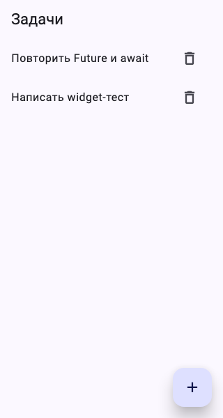
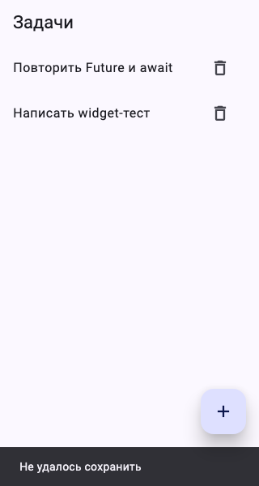

# Практика Flutter: Todo с памятью и тестами

За **80 минут** добавьте сохранение задач к готовому интерфейсу Todo. После перезапуска приложение восстанавливает список из `SharedPreferencesAsync`. При ошибке чтения можно повторить загрузку. При сбое записи список остаётся прежним.

Форма добавления, диалог удаления, вёрстка списка, модель `Todo`, кодирование и чтение JSON и тестовые хранилища уже готовы. Работайте в трёх файлах `lib/` и в `test/student_checks.dart`. Ориентир — около 75 непустых строк, включая четыре теста.

## Запуск

Нужны Flutter SDK и Chrome. Проверено на Flutter 3.35.7 / Dart 3.9.2.

Склонируйте репозиторий или скачайте его через Code → Download ZIP.

```sh
git clone https://github.com/GeorgFed/flutter-todo-storage-testing-task.git
cd flutter-todo-storage-testing-task
```

Если скачали ZIP, распакуйте его. Выполните команды в папке с `pubspec.yaml`.

```sh
flutter pub get
flutter run -d chrome
```

`shared_preferences: 2.5.3` уже есть в зависимостях. Для `pub get` нужен доступ к pub.dev или заранее заполненный кэш. Экран «Начните с TODO 1» — ожидаемый результат запуска чистого шаблона. В терминале приложения `r` запускает hot reload, `R` — hot restart, `q` завершает запуск.

## Макет

Снимки готового приложения при ширине **320 logical px** и высоте 600. Стандартных виджетов достаточно. Ориентируйтесь на состояния экрана и доступность действий.

<table>
  <tr><th>Пустой список</th><th>Задачи загружены</th><th>Ошибка чтения</th><th>Сбой записи</th></tr>
  <tr>
    <td><a href="docs/screenshots/empty.png"></a></td>
    <td><a href="docs/screenshots/list.png"></a></td>
    <td><a href="docs/screenshots/read_error.png"></a></td>
    <td><a href="docs/screenshots/save_error.png"></a></td>
  </tr>
</table>

## Что реализовать

| TODO | Работа |
|---|---|
| **1 · Репозиторий** | В `lib/storage.dart` реализуйте `TodoRepository.load` и `save`. Свяжите `TextStore` с готовыми `decodeTodos` и `encodeTodos`. Если `read()` вернул `null`, верните пустой список. Ошибки передавайте вызывающему коду. |
| **2 · Адаптер** | В `lib/preferences_store.dart` свяжите `read()` и `write(value)` с `SharedPreferencesAsync.getString` и `setString`. Используйте переданный `key`. Ключ по умолчанию — `practice.todos`. |
| **3 · Экран** | В `lib/main.dart` запустите `loadTodos` из `initState`. Обработайте загрузку, результат и ошибку. В `persistNext` дождитесь сохранения нового списка. Выберите состояние в `body()` и блокируйте кнопки через `busy`. |
| **4 · Четыре теста** | Заполните три unit-теста и один widget-тест в `test/student_checks.dart`. Готовые фикстуры и помощники можно использовать как есть. |

### Формат и хранилище

Задачи хранятся одной строкой JSON, например `[{"id":7,"title":"Купить чай"}]`. Готовые функции сохраняют поля и порядок задач. При чтении `decodeTodos` ожидает массив объектов, а `Todo.fromJson` проверяет, что у каждой задачи `id` — `int`, а `title` — `String`. Сломанный JSON и неверные типы дают `FormatException`.

`TextStore.read()` возвращает `Future<String?>`, `write(value)` — `Future<void>`. Отсутствующая запись (`null`) означает первый запуск. Повреждённую запись оставьте в хранилище, чтобы повторить чтение после исправления.

### Состояния экрана

- До завершения чтения виден `CircularProgressIndicator`. Успешное чтение показывает список или «Пока нет задач».
- Ошибка чтения показывает «Не удалось прочитать задачи» и «Повторить». Кнопка запускает чтение снова.
- Загрузка, запись и ошибка чтения блокируют добавление. При записи также нельзя начать новое удаление.
- Пессимистичная запись означает, что список на экране обновляется только после успешного завершения `save`. При сбое покажите SnackBar «Не удалось сохранить» и оставьте прежний список. Снимите блокировку в `finally`, если экран всё ещё открыт.
- После `await` проверьте `mounted` перед обращением к состоянию или контексту экрана. Форма возвращает название или `null`, диалог разрешает удаление только при `true`. Одинаковые названия допустимы, поэтому строка и удаление привязаны к `id`.

Сохраните ключи `add_todo_button`, `todo_title_field`, `save_todo_button`, `retry_button` и `ValueKey(todo.id)`, подсказку «Удалить» на кнопке строки и тексты сообщений.

### Четыре теста

1. **Восстановление.** Запишите две задачи с id 7 и 2 в `MemoryStore`. Создайте новый репозиторий над тем же хранилищем и проверьте оба id, оба названия и порядок.
2. **Первый запуск и повреждённые данные.** Убедитесь, что `null` даёт пустой список. Прочитайте готовый массив с кириллицей и сравните поля. Проверьте `FormatException` для сломанного JSON `[{"id":7` и строкового id `[{"id":"7","title":"Чай"}]`.
3. **Сбой записи.** Подготовьте хранилище с одной задачей и задайте `store.writeError`. Дождитесь проверки исключения из `save` через `await expectLater(..., throwsA(same(failure)))` и убедитесь, что прежняя задача по-прежнему читается.
4. **Загрузка и добавление.** На `PendingStore` проверьте индикатор до `complete` и задачу после `pump`. Затем запустите новый экран на `MemoryStore`, добавьте задачу через «+» и форму. Проверьте, что она появилась в списке и сохранилась в хранилище.

## Приёмка

1. Первый запуск показывает пустой список. Добавьте две задачи и перезагрузите страницу в том же профиле Chrome. Обе задачи восстановились в исходном порядке.
2. Отмена диалога сохраняет список. Подтверждение удаляет выбранную задачу по id. После перезагрузки удалённая задача отсутствует.
3. При ошибке чтения можно повторить загрузку. Добавление до успешного чтения заблокировано. Сбой записи показывает сообщение, прежний список остаётся на экране.
4. На экране 320×600 доступны список и действия, включая форму и диалог. Проходят четыре ваших теста и готовая самопроверка.

Проверить настройку и запуск шаблона:

```sh
flutter analyze
flutter test
```

Проверить завершённую работу:

```sh
flutter test test/student_checks.dart test/behavior_check.dart
```

Последняя команда ожидаемо сообщает об ошибках до заполнения TODO. `student_checks.dart` заполняете вы. `behavior_check.dart` — готовая самопроверка, оставьте её без правок.

## Оценивание · 0–2 балла

Оценка накопительная. Критерии объявляются перед началом практики.

| Баллы | Проверяемый результат |
|---|---|
| **0** | Сценарий добавления с восстановлением после перезапуска не работает или студент не может объяснить, как данные возвращаются на экран. |
| **1** | Задача добавляется и восстанавливается после перезапуска через `SharedPreferencesAsync` и репозиторий. Работает unit-тест восстановления через новый репозиторий. Студент объясняет путь данных и показывает, что проверяет тест. |
| **2** | Выполнен уровень 1. Репозиторий использует готовый JSON-кодек. Реализованы загрузка и повтор чтения, добавление и удаление с подтверждением, пессимистичная запись и безопасная работа после `await`. Проходят анализ, четыре осмысленных теста студента и самопроверка. Студент объясняет обработку ошибок, порядок записи и способ управления загрузкой в widget-тесте. |

Ориентир по времени — 5 минут на запуск, 20 на репозиторий и адаптер, 25 на экран, 20 на тесты, 10 на проверку и объяснение. Разрешены документация и примеры лекции. Подготовьтесь объяснить свой код.

## Сдача

Подготовьте ссылку на репозиторий и точный commit с исходниками и четырьмя тестами. Приложите вывод команд проверки и короткую запись добавления, перезагрузки страницы и удаления задачи. Срок и канал сдачи преподаватель сообщает отдельно.

## Документация

- [SharedPreferencesAsync в shared_preferences 2.5.3](https://pub.dev/packages/shared_preferences/versions/2.5.3)
- [Кодирование и декодирование JSON в Dart](https://dart.dev/libraries/dart-convert)
- [State.mounted](https://api.flutter.dev/flutter/widgets/State/mounted.html)
- [Unit-тесты во Flutter](https://docs.flutter.dev/cookbook/testing/unit/introduction), [widget-тесты и pump](https://docs.flutter.dev/cookbook/testing/widget/introduction)
